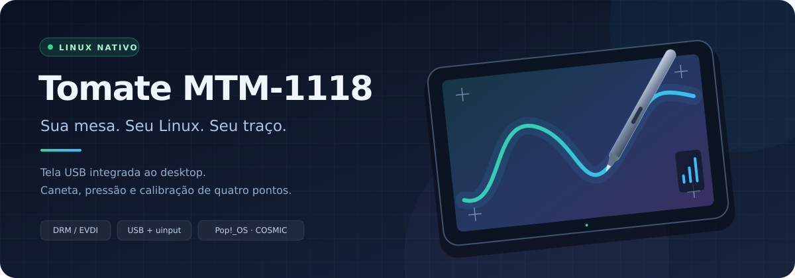
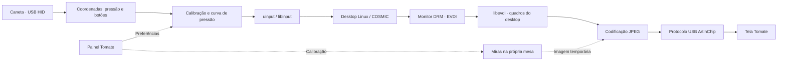

<div align="center">



# Tomate MTM-1118 · Linux

**Sua mesa digitalizadora como uma tela do Linux, com caneta e pressão.**

Driver independente para a **Tomate MTM-1118**, desenvolvido por engenharia reversa dos drivers Windows e integrado ao desktop por **DRM/EVDI**, **USB** e **uinput**.


[](LICENSE)

[**Baixar o instalador**](https://github.com/Alefk1708/tomate-mtm1118-linux/releases/tag/v2.3.12) · [Instalação](#instalação) · [Calibração](#calibração) · [Como funciona](#como-funciona) · [Licença e créditos](#licença-e-créditos) · [Reportar um problema](https://github.com/Alefk1708/tomate-mtm1118-linux/issues)

</div>

---

## O que este projeto faz

Transforma a Tomate MTM-1118 em um **monitor USB do próprio desktop Linux**. Você pode organizar a mesa ao lado das outras telas, mover janelas para ela e desenhar com a caneta em aplicativos compatíveis.

A mesa usa **a mesma sessão, os mesmos programas e os mesmos arquivos do computador**. Ao salvar um desenho, ele fica no armazenamento do seu PC, na pasta escolhida no aplicativo.

| Recurso | Implementação |
| :--- | :--- |
| **Tela integrada ao desktop** | Saída DRM criada pelo EVDI; extensão ou espelhamento configurados no desktop. |
| **Imagem por USB** | Transporte ArtInChip reconstruído dos drivers Windows; caminho JPEG usado na unidade validada. |
| **Caneta e pressão** | Leitura dos relatórios USB HID e emissão de eventos Linux por `uinput`. |
| **Botões configuráveis** | Atalhos, cliques, desfazer/refazer e outras ações escolhidas no painel. |
| **Ajustes de desenho** | Curva de pressão, sensibilidade, faixa de pressão e inversão dos eixos/tela. |
| **Calibração de quatro pontos** | Miras enviadas diretamente à tela da mesa, com confirmação de cada ponto. |
| **Reconexão** | Serviços recuperam a entrada e a imagem após desconexões; o desktop pode exigir reativar a saída. |
| **Painel de controle** | Interface gráfica em português, com estado da caneta e pressão em tempo real. |

> [!IMPORTANT]
> Este é um **projeto em desenvolvimento**, com validação prática no Pop!_OS. A integração DRM já foi usada para desenhar no Krita. O fluxo da revisão **2.3.11** passou por **39 verificações simuladas**, mas ainda precisa de confirmação física no notebook com três telas. A **2.3.12** acrescenta licença e créditos, mantendo esse comportamento do driver. Veja as [limitações conhecidas](#limitações-conhecidas).

## Compatibilidade

| Ambiente | Situação |
| :--- | :--- |
| **Tomate MTM-1118** | Modelo que orienta o desenvolvimento e os testes. |
| **Pop!_OS 24.04 · Wayland/COSMIC** | Ambiente principal relatado nos testes físicos. |
| **Ubuntu / derivados com `apt` e `systemd`** | Instalador preparado para essas bases; outras combinações de desktop/kernel precisam de validação. |
| **Ryzen 5 5500 + NVIDIA RTX 4060** | Integração DRM confirmada pelo usuário em revisão anterior. |
| **Notebook Intel i5 com gráficos integrados** | Imagem e entrada relatadas; a calibração com três telas motivou a revisão 2.3.11. |
| **WSL / Windows** | O instalador desta edição exige Linux instalado diretamente no computador. |
| **Outros modelos e desktops Linux** | Suporte completo não validado. |

Na unidade usada no desenvolvimento, a tela informa **1280 × 800 a 58 Hz**. O fluxo limita a taxa a até 60 quadros/s e à frequência fornecida pelo compositor; o desempenho real depende de USB, CPU e desktop.

**Você vai precisar de:**

- Linux nativo com `apt`, `systemd` e uma sessão gráfica.
- Conexões USB da **tela e da caneta** presentes. A imagem e o digitalizador são dispositivos distintos.
- Internet e senha de administrador para a primeira instalação.
- Headers correspondentes ao kernel e um módulo EVDI compatível. O instalador tenta preparar esses componentes automaticamente.

## Instalação

### Opção 1 · Baixar e abrir o instalador

1. Na [release v2.3.12](https://github.com/Alefk1708/tomate-mtm1118-linux/releases/tag/v2.3.12), baixe **`tomate-mtm1118-linux-v2.3.12.tar.gz`**.
2. Extraia **o pacote inteiro** para uma pasta local.
3. Salve os documentos abertos e conecte a mesa.
4. Abra **`Instalar.desktop`** com duplo clique. Se o gerenciador de arquivos pedir permissão para executar o lançador, permita.
5. Informe a senha de administrador e aguarde a conclusão.

O lançador abre um terminal e executa o instalador incluído no pacote. Se o desktop não abrir arquivos `.desktop` locais, abra um terminal na pasta extraída e use:

```bash
sudo bash install.sh
```

### Opção 2 · Clonar pelo terminal

Com o Git instalado:

```bash
git clone https://github.com/Alefk1708/tomate-mtm1118-linux.git
cd tomate-mtm1118-linux
sudo ./install.sh
```

**DRM é o único modo desta edição:** não é necessário informar uma opção de modo. O instalador não inclui o Krita; instale seus aplicativos de desenho separadamente.

### O que o instalador prepara

- Dependências Python, USB, interface gráfica e ferramentas de entrada.
- Headers, DKMS e **EVDI 1.15.1**, quando necessários, com verificação do arquivo baixado por SHA-256.
- Biblioteca `libevdi` privada e arquivos do driver em `/opt/tomate-mtm1118`.
- Serviços de imagem e caneta, regras USB, ajuste de pressão do libinput e lançadores.
- Grupo de permissões `tomate-tablet` e associação da caneta à saída Tomate no COSMIC.
- Licença, avisos e créditos também copiados para a pasta do programa instalado.
- Backup dos arquivos e serviços anteriores em `/var/backups/tomate-mtm1118/final-*`.

O instalador verifica os componentes EVDI antes de substituir os serviços. Se a substituição falhar, tenta restaurar os arquivos e serviços anteriores; pacotes instalados pelo `apt` e o preparo do EVDI não são desfeitos. O kernel e as opções de Secure Boot não são alterados pelo projeto.

### Depois de instalar

1. Abra **Configurações → Telas** e ative a Tomate, se necessário. Organize as telas ou escolha o espelhamento.
2. Abra **Mesa Tomate MTM-1118** no menu de aplicativos, **sem `sudo`**.
3. Se solicitado pelo instalador, saia da sessão e entre novamente para carregar permissões e ajustes de entrada.
4. Se houver imagem, mas a caneta não mover o cursor, use **Calibração → Associar caneta à tela Tomate**.

O painel também pode ser aberto pelo terminal:

```bash
tomate-tablet-settings
```

<details>
<summary><strong>Atualizar uma instalação existente</strong></summary>

Encerre o painel antigo pelo botão **Sair**, extraia a nova versão numa pasta separada e rode `sudo ./install.sh`. **Fechar pelo X apenas minimiza o painel**; é necessário encerrá-lo para carregar o código atualizado.

Se estiver usando um clone Git sem alterações locais, execute `git pull --ff-only` antes de instalar. As preferências existentes de pressão, calibração e botões são preservadas. A instalação reinicia os serviços da mesa, por isso salve o trabalho primeiro.

Após abrir o painel novamente, confira **v2.3.12** em **Sobre**. Atualize sempre o pacote completo: painel, caneta e imagem usam o mesmo protocolo de calibração.

</details>

## Caneta e botões

Use o painel para ajustar a pressão e escolher a ação de cada botão. O perfil padrão desta edição é:

| Controle | Ação padrão |
| :--- | :--- |
| Ponta | Contato de desenho com pressão. |
| Botão superior | Clique do meio. |
| Botão inferior | Clique direito. |
| Entrada auxiliar | Desativada; o controle físico correspondente não foi confirmado. |

Para uma configuração comum no Krita, atribua **Tecla de atalho → Space** ao superior e **Clique direito** ao inferior. O comportamento final também depende dos atalhos e das configurações do aplicativo.

Ao mudar uma atribuição com um botão pressionado, **solte e pressione novamente** para iniciar a nova ação. A instalação preserva as atribuições já salvas; os padrões acima valem para o perfil novo ou restaurado.

Se alguma tecla ou contato ficar preso, use **Status → Liberar teclas e reativar caneta**. A recuperação libera os eventos de entrada sem reiniciar a imagem.

## Calibração

A versão 2.3.11 apresenta as miras **diretamente no vídeo enviado à Tomate**. A calibração não usa a numeração dos monitores nem a posição das janelas do XWayland, evitando essa dependência em disposições com duas ou três telas.

1. Abra **Calibração** e clique em **Calibrar**.
2. Olhe para a **tela física da mesa**. O desktop será temporariamente substituído pelas miras.
3. Encoste a ponta no centro da mira e **levante** para confirmar. Aguarde a próxima posição.
4. Complete os quatro pontos e confirme para salvar.

```text
       1 · Superior esquerdo ────────── 2 · Superior direito
                  ▲                             │
                  │                             ▼
       4 · Inferior esquerdo ◀───────── 3 · Inferior direito
```

A janela do painel mostra o progresso e o botão **Cancelar**; ela pode ficar em qualquer outro monitor. **Não pressione os botões laterais durante a calibração.** Ao concluir ou cancelar, a imagem mais recente do desktop volta à mesa.

Cada ponto só é armado após o serviço de imagem confirmar o envio USB daquela mira. Toques agrupados perto de um ponto anterior são recusados para evitar uma área de calibração muito pequena. A calibração anterior é preservada se a tentativa for cancelada ou inválida.

> [!TIP]
> **1280×800** é uma resolução. **1920:280**, exibido na lista de monitores antiga, era uma posição **X:Y** no desktop. O botão **Detalhes** agora separa a resolução física do modo de imagem atual.

Se a comunicação parar, a caneta desconectar ou um ponto não avançar por 90 segundos, a tentativa é encerrada com uma mensagem. **ESC** ou **Cancelar** encerra a calibração manualmente.

## Como funciona

O projeto tem dois serviços independentes: um envia a imagem por USB e o outro traduz os relatórios da caneta para eventos de entrada Linux. O painel configura os dois e coordena a calibração.



**Imagem.** O EVDI anuncia uma saída de monitor com o EDID obtido da mesa. O compositor desenha nessa saída, e a `libevdi` entrega os pixels ao serviço de imagem. O serviço converte o quadro e o transmite pelo protocolo ArtInChip reconstruído a partir do driver Windows.

**Entrada.** O serviço lê a interface USB HID do digitalizador. Os relatórios incluem coordenadas, pressão, botões e, quando fornecida, inclinação. A calibração transforma as coordenadas; a curva ajusta a pressão. Dispositivos virtuais `uinput` entregam os eventos ao Linux, preservando a integração com os aplicativos.

**Latência.** A captura não acrescenta a antiga espera fixa de 20 ms. O serviço solicita a próxima atualização enquanto codifica/envia o quadro atual, mantém um único buffer e reutiliza o último quadro quando a imagem está parada. Essas escolhas evitam uma fila de imagens antigas; não representam uma garantia de latência física específica.

**Calibração.** Painel, serviço de caneta e serviço de imagem trocam arquivos JSON de estado e comandos em `/run/tomate-mtm1118`. Uma identificação de sessão, a etapa e a confirmação do quadro impedem que uma mira anterior autorize a captura da seguinte.

<details>
<summary><strong>Estrutura do código e arquivos instalados</strong></summary>

```text
tomate-mtm1118-linux/
├── Instalar.desktop           # Lançador de instalação com duplo clique
├── Instalar.sh                # Solicitação de privilégios e execução
├── install.sh                 # Dependências, EVDI, serviços e integração
├── uninstall.sh               # Remoção dos componentes do projeto
├── display-driver/            # Transporte ArtInChip, libevdi e miras
├── userspace-pen/             # USB HID, pressão, botões e calibração
├── gui/                       # Painel de controle Tkinter e recursos
├── scripts/                   # Ambiente, instalação EVDI e associação COSMIC
├── systemd/                   # Serviços da caneta e da imagem
├── udev/                      # Regras USB e ajuste de pressão libinput
├── xorg/                      # Configuração do dispositivo para X11
└── docs/                      # Identidade visual do repositório
```

| Caminho / serviço | Finalidade |
| :--- | :--- |
| `/opt/tomate-mtm1118` | Programas e biblioteca privada EVDI. |
| `/etc/tomate-mtm1118/settings.json` | Preferências persistentes do driver. |
| `/run/tomate-mtm1118` | Estado temporário e comunicação da calibração. |
| `/var/backups/tomate-mtm1118` | Backups de instalação e remoção. |
| `tomate-pen.service` | Caneta, pressão, botões e dispositivos virtuais. |
| `tomate-display-monitor.service` | Monitor DRM e transmissão da imagem. |

O instalador não precisa dos executáveis ou módulos Windows originais. IDs USB observados na unidade: tela **`33c3:0e02` / `33c3:0e01`**, digitalizador **`0ed1:7821` / `0ed1:7856`**. Outros IDs presentes no código não significam compatibilidade integral com outros modelos.

</details>

## Diagnóstico

Na pasta do projeto, a consulta do ambiente é feita sem instalar componentes:

```bash
bash install.sh --check
```

Para consultar os serviços e os logs:

```bash
systemctl status tomate-pen.service tomate-display-monitor.service --no-pager
journalctl -u tomate-pen.service -b -n 80 --no-pager
journalctl -u tomate-display-monitor.service -b -n 80 --no-pager
```

| Sintoma | O que conferir |
| :--- | :--- |
| Imagem funciona, cursor não se move | Conexão USB do digitalizador e **Associar caneta à tela Tomate**. No COSMIC, também é possível executar `tomate-map-pen` sem `sudo`. |
| Mesa conectada, mas sem imagem | Ativação em **Configurações → Telas**, estado do serviço de imagem e logs de EVDI. |
| Mira não avança ou painel parece antigo | Encerrar pelo botão **Sair**, instalar o pacote completo e conferir a versão em **Sobre**. |
| Botão ou tecla fica preso | Soltar os botões e usar **Liberar teclas e reativar caneta** no painel. |
| Módulo EVDI não carrega | Headers do kernel, versão do módulo, logs do kernel e eventual recusa por Secure Boot. |

Os logs de vídeo informam FPS e tempos de captura, codificação e USB. Eles **não medem o atraso físico completo da tela**.

## Limitações conhecidas

- **Integração com o COSMIC:** houve relatos de cliques da caneta ignorados em controles do sistema, como fechar janelas, apesar do desenho funcionar nos aplicativos.
- **Botões e contato:** ainda há relatos ocasionais de falha do botão superior e de traços com a ponta no ar. As revisões 2.3.11 e 2.3.12 preservam o comportamento de entrada escolhido durante os testes; não declaram esses casos eliminados.
- **Estabilidade gráfica:** uma revisão anterior apresentou travamento com NVIDIA/COSMIC/EVDI. Testes posteriores permitiram desenhar normalmente, mas ainda falta uma matriz ampla de GPUs, kernels e aplicativos.
- **Calibração atual:** o fluxo direto por USB foi verificado por simulação. A confirmação física da correção no notebook com três telas está pendente.
- **Touch e outros dispositivos:** há comandos de configuração de touch no código, mas funcionamento completo de touchscreen/multitoque e de outros modelos não foi validado.
- **Formatos de vídeo:** há identificação de H.264 no protocolo, mas o encoder correspondente não está implementado. O caminho validado usa JPEG.

## Desinstalação

Na pasta do projeto:

```bash
sudo ./uninstall.sh
```

Se a pasta foi extraída sem permissões de execução, use `sudo bash uninstall.sh`.

A remoção retira programas, serviços, regras e lançadores do projeto. **Preferências em `/etc/tomate-mtm1118`, backups e desenhos pessoais são preservados.** Pacotes compartilhados do sistema e EVDI não são removidos automaticamente.

<details>
<summary><strong>Opções avançadas do instalador</strong></summary>

```bash
sudo ./install.sh --user seu_usuario
sudo ./install.sh --no-deps
./install.sh --help
```

`--user` informa a conta gráfica quando a instalação é iniciada diretamente como root. `--no-deps` pressupõe todos os componentes necessários já preparados; não é a opção recomendada para a primeira instalação.

</details>

## Contribuir e relatar problemas

Abra uma [issue](https://github.com/Alefk1708/tomate-mtm1118-linux/issues) com o modelo da mesa, versão do driver, GPU, disposição dos monitores e passos para reproduzir o problema. Inclua os logs dos serviços e a saída de:

```bash
uname -r
echo "$XDG_SESSION_TYPE / $XDG_CURRENT_DESKTOP"
lsusb
```

Para contribuir com código, descreva o comportamento antes/depois e diferencie testes simulados de testes na mesa física. Resultados com outros notebooks, GPUs e versões do COSMIC ajudam a ampliar a compatibilidade documentada.

## Licença e créditos

**Projeto e port Linux: [Alefk1708](https://github.com/Alefk1708).** Copyright 2026 Alefk1708. O código original, a documentação e o banner do repositório são disponibilizados sob a **[Apache License 2.0](LICENSE)**.

A licença permite uso, cópia, modificação e redistribuição, inclusive comercial. Nas redistribuições, suas condições incluem:

- Fornecer uma cópia da licença.
- Preservar os avisos de copyright e atribuição aplicáveis ao trabalho reutilizado.
- Identificar os arquivos modificados com avisos das alterações.
- Manter uma cópia legível dos créditos aplicáveis do **[NOTICE](NOTICE)** em um dos locais previstos pela seção 4 da licença.

Assim, outras pessoas podem contribuir e criar suas próprias versões, mantendo os avisos de origem exigidos. A licença estabelece obrigações de atribuição; não é uma barreira técnica à cópia nem uma garantia contra plágio.

Veja **[AUTHORS.md](AUTHORS.md)** para a identificação do projeto e **[THIRD_PARTY_NOTICES.md](THIRD_PARTY_NOTICES.md)** para os recursos herdados do driver original. Esses recursos de terceiros mantêm os direitos dos respectivos titulares e **não são relicenciados como Apache 2.0**.

O instalador inclui esses avisos em `/opt/tomate-mtm1118`, e a janela **Sobre** identifica o port Linux e seus créditos. Contribuições intencionalmente enviadas ao projeto seguem a seção 5 da licença, salvo indicação expressa em contrário.

## Origem e referências

O protocolo de imagem ArtInChip e os relatórios Bosto foram reconstruídos dos drivers Windows fornecidos para a mesa, usando **REA e Ghidra**. Os fontes registram funções e hashes associados à análise. A execução no Linux usa as implementações deste repositório.

- [EVDI e API pública da libevdi 1.15.1](https://github.com/DisplayLink/evdi/blob/v1.15.1/library/evdi_lib.h)
- [Interface uinput do kernel Linux](https://docs.kernel.org/input/uinput.html)
- [Ajustes de dispositivos no libinput](https://wayland.freedesktop.org/libinput/doc/latest/device-quirks.html)
- [Implementação de entrada do COSMIC](https://github.com/pop-os/cosmic-comp/tree/master/src/input)
- [Especificação de lançadores `.desktop`](https://specifications.freedesktop.org/desktop-entry/latest/exec-variables.html)

Projeto independente, sem vínculo oficial com os fabricantes citados. Os recursos visuais herdados do painel original e o aviso em [`gui/assets/copyright.txt`](gui/assets/copyright.txt) foram preservados; sua presença não estabelece uma licença geral para conteúdo de terceiros.

---

<div align="center">

**Tomate MTM-1118 no Linux** · tela, caneta e calibração no mesmo desktop.

</div>
